# DevCraft · estudo de caso

**Site comercial de uma agência de sites para pequenos negócios.**
Projeto próprio, do briefing à publicação.

`Projeto próprio` · `One-page + quiz de orçamento` · `Next.js e React` · `Captura de leads`

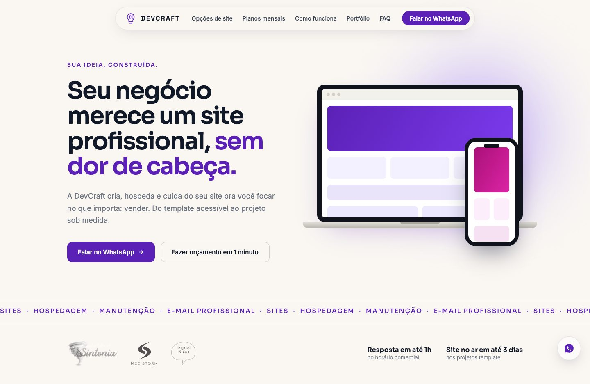

> A DevCraft é uma agência de criação de sites de Salvador/BA. Este repositório
> mostra o resultado e o raciocínio do projeto; **o código-fonte fica em um
> repositório privado.** O site está no ar em [devcraft.dev.br](https://devcraft.dev.br).

---

## O desafio

A DevCraft cria, hospeda e cuida de sites pra pequenos negócios. O site foi
desenhado pra um funil simples: a visita chega (principalmente pelo Instagram),
entende as opções em uma página só e conversa no WhatsApp, ou responde um quiz
de 1 minuto e recebe uma estimativa na hora, com cupom de desconto.

**Como o funil funciona:**

1. A **one-page** apresenta opções de site, planos mensais, processo, portfólio e FAQ.
2. O **quiz de orçamento** (5 perguntas) calcula uma recomendação personalizada de produto e plano.
3. O lead cai automaticamente numa **planilha Google** e dispara um **alerta por e-mail**, com marcação de urgência.
4. A página de obrigado entrega a estimativa e o **cupom de desconto**, e leva a conversa pro WhatsApp.
5. Cada botão de WhatsApp do site tem **mensagem própria**, revelando em que ponto do funil o cliente estava quando clicou.

---

## Direção visual

**Roxo chapado, fundo off-white e muito respiro.** Design system próprio, sem
gradientes vibrantes: a cor entra pelos botões, pelos números de seção e pelos
destaques do texto. Elementos de vidro (*liquid glass*) só onde ajudam a
leitura, como a navbar em pílula e os cards do quiz, e um efeito de "lanterna"
no rodapé.

| Cor | Papel no site |
|---|---|
| Roxo Profundo `#5B21B6` | cor principal: botões, links e destaques |
| Roxo Médio `#7C3AED` | estados de hover |
| Roxo Suave `#A78BFA` | detalhes e bordas |
| Carvão `#111827` | texto e rodapé |
| Off-white `#FAF7F2` | fundo |

**Tipografia:** Sora nos títulos, preços e números, Inter no texto corrido e
Space Grotesk só no wordmark DEVCRAFT.

---

## Home

### Hero
A promessa da agência, dois caminhos (WhatsApp ou orçamento em 1 minuto) e,
logo abaixo, uma faixa com os serviços e os logos de clientes.

### Opções de site
Três caminhos lado a lado: site template, site WordPress e site personalizado,
com preço de lançamento e o que cada um inclui.

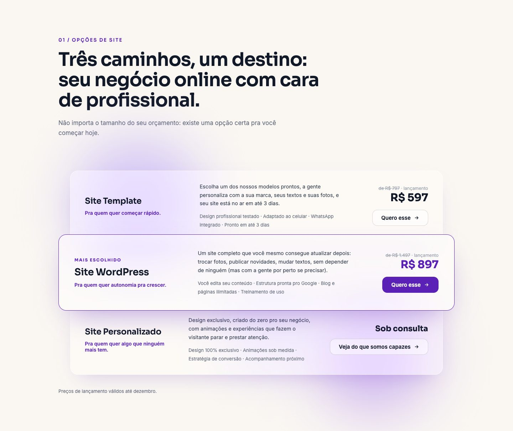

### Planos mensais
Hospedagem, domínio, e-mail e manutenção em dois planos, Essencial e
Tranquilidade.

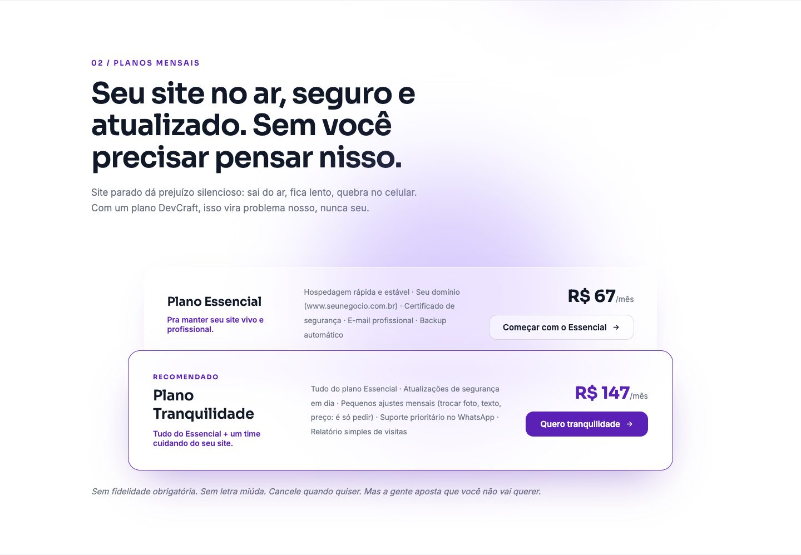

### Como funciona
Os quatro passos do primeiro "oi" ao site no ar, num player que avança sozinho.

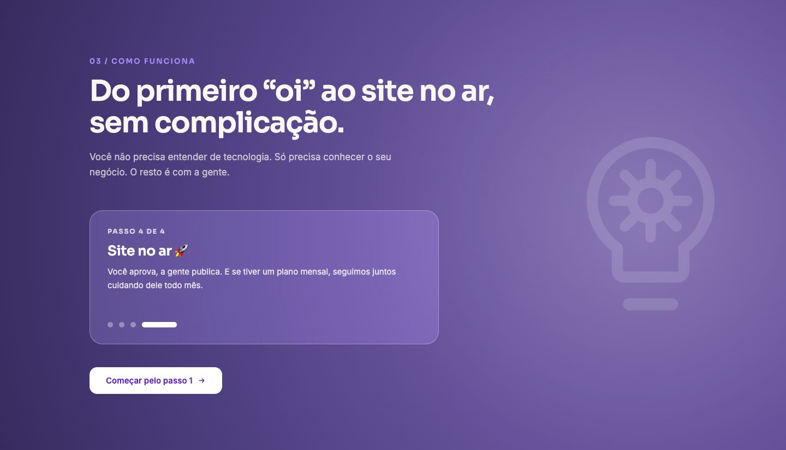

### Portfólio
Os sites de clientes aparecem **rodando em vídeo**: screen-captures reais em
loop, com a lista de projetos à esquerda e a prévia à direita.

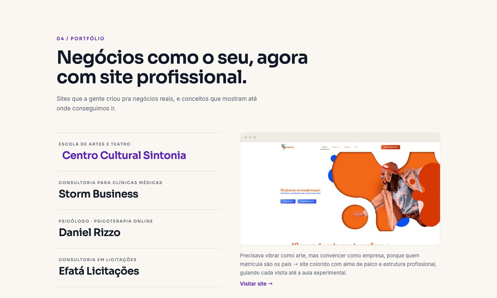

Logo abaixo, os **estudos de design** ("design por esporte"), sites de estudo
que mostram o padrão de qualidade, e os depoimentos de quem contratou.

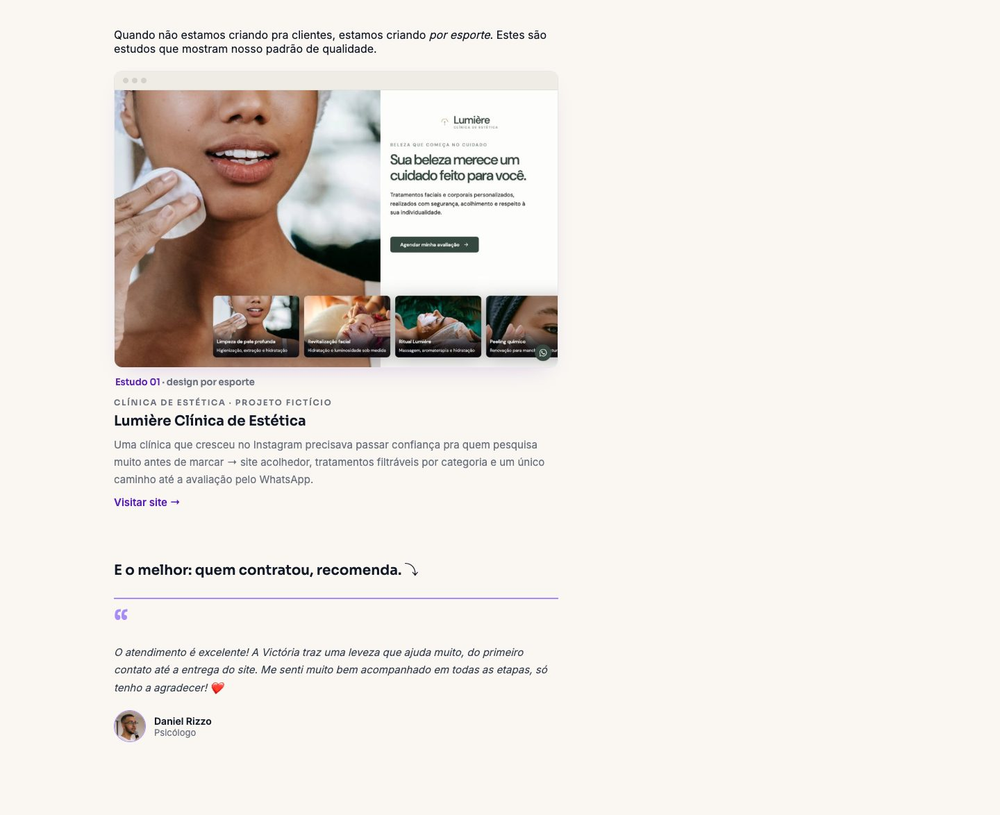

### Quem faz
A pessoa por trás da agência, pra quem chega pelo Instagram e quer saber com
quem vai falar.

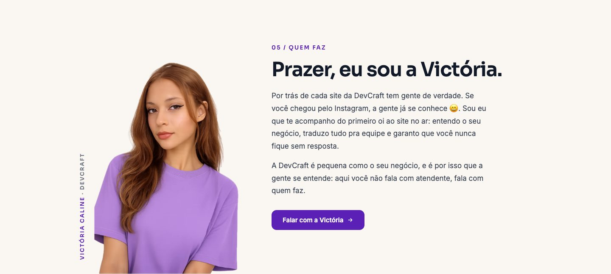

### Perguntas frequentes
As dúvidas de sempre, de preço a prazo, com um atalho pro WhatsApp.

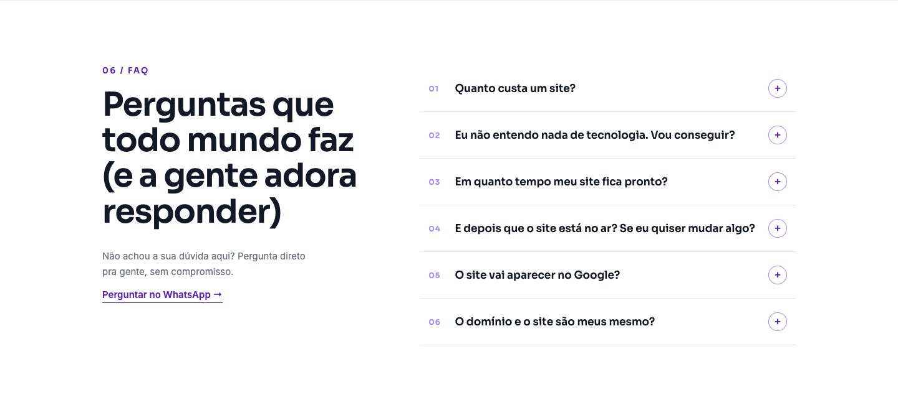

### Chamada final e rodapé

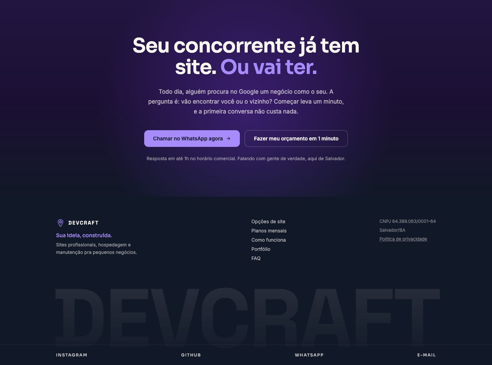

---

## Quiz de orçamento

Cinco perguntas rápidas que terminam numa recomendação personalizada de produto
e plano, com a estimativa de preço e o cupom de desconto.

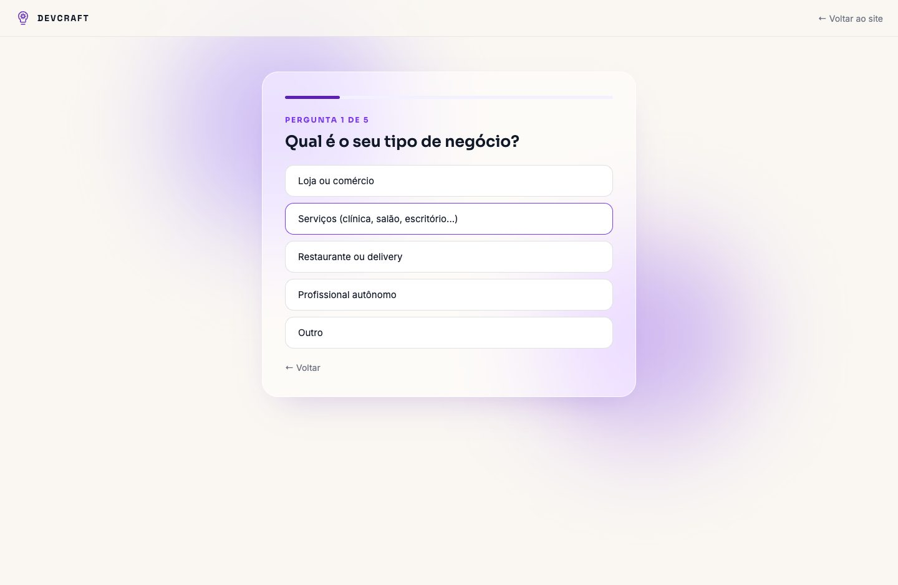

---

## No celular

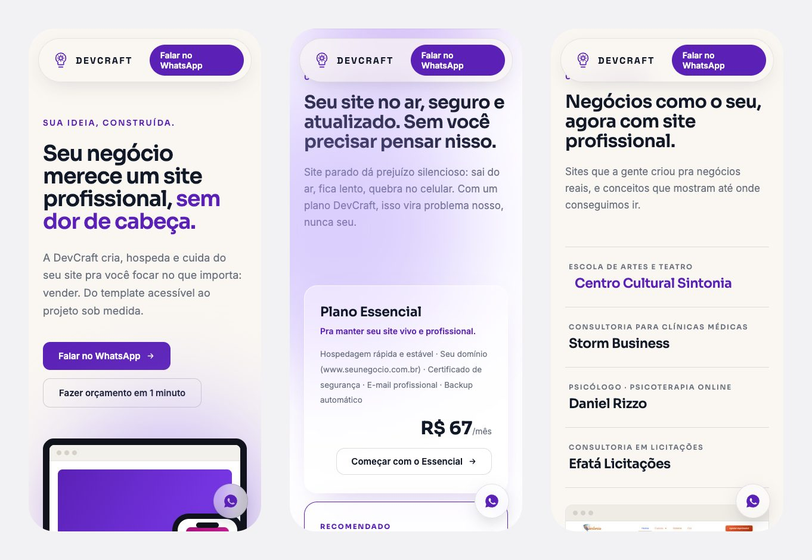

---

## Decisões que fizeram diferença

**Conversão**
- Um funil só, do Instagram ao WhatsApp, com o quiz como atalho pra quem ainda está decidindo.
- Mensagem própria em cada botão de WhatsApp, pra saber de onde veio cada conversa.

**Portfólio vivo**
- Screen-captures reais dos sites dos clientes em mp4 leves (até 1,5 MB), com
  carregamento sob demanda, poster de reserva e respeito a `prefers-reduced-motion`.

**Técnica**
- Captura de leads resiliente: falha de integração nunca bloqueia o usuário.
- LGPD: política de privacidade completa, dados mínimos e canal de exclusão.
- SEO: FAQ com dados estruturados (JSON-LD), sitemap e Open Graph pra prévia bonita no WhatsApp.

---

## Ficha técnica

| | |
|---|---|
| **Cliente** | DevCraft (projeto próprio) |
| **Páginas** | One-page, quiz de orçamento, página de obrigado e política de privacidade |
| **Front-end** | Next.js 15 (App Router), React 19 e CSS próprio, sem frameworks |
| **Integrações** | Google Sheets (Apps Script) e Resend |
| **Hospedagem** | Vercel, com domínio próprio |
| **Código** | repositório privado |

---

Projeto desenvolvido pela [DevCraft](https://devcraft.dev.br).
